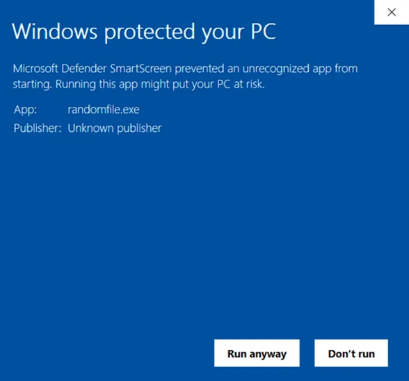

# Sekura PasteGuard

A small Windows tray app that watches your clipboard for two things. Shell commands that look like ClickFix payloads, and tracking parameters on URLs.

## Download

[Get the latest installer from the releases page](https://github.com/mkultraware/PasteGuard/releases).

## What it does

**ClickFix protection.** Attackers fake CAPTCHAs and error pages to get you to copy and run a command. PasteGuard watches the clipboard, and when it sees a shell command, it warns you before you can paste it into a terminal.

**Tracking removal.** When you copy a link from Amazon, Facebook, TikTok, LinkedIn, or Google, it comes with tracking parameters. PasteGuard strips them so you paste a clean URL.

## Detection

Two tiers, so it catches real payloads without flagging prose.

Tier 1 fires on its own: `cmd /c`, `powershell`/`pwsh -flag`, `-enc`/`-e` base64 payloads, `Invoke-WebRequest`/`irm` to an `https://` URL, `Invoke-Expression`, `DownloadString`, `curl` with an `https://` URL, `reg add HKEY`/`HKCU`/`HKLM`, `bash -c`, `certutil` fetch/decode, `bitsadmin` transfer, `net user`/`localgroup` add/delete/reset, `Start-Process`, `New-Object System.Net.WebClient`, and dynamic invocation like `& ($var)`. The `cmd`, `powershell`/`pwsh`, and `reg add` patterns must start the line, so prose mentioning them mid-sentence does not fire. Flags and quoted arguments are tolerated between the executor and the URL, so `curl -L`, `iwr -uri`, and `certutil "-urlcache ..."` are caught.

Tier 2 needs a tool name plus a shell signal. `mshta`, `rundll32`, `certutil`, `wmic`, and friends only trigger when followed by a flag, URL, pipe, or script extension. So "I read a blog post about mshta and rundll32 today" passes through clean.

This is a speed bump, not a security boundary. A determined attacker can reword a payload past these patterns; PasteGuard warns, it does not prove what a command does.

## SmartScreen

The installer is not code-signed. If you download it from the releases page, Windows SmartScreen will show a "Windows protected your PC" warning. That is expected for an unsigned build. Click "More info" then "Run" to continue.



## Building

The repo ships source, not binaries. To build the exe and installer:

1. Install [Inno Setup 6](https://jrsoftware.org/isinfo.php)
2. Run `build.ps1`

That creates a venv, installs dependencies, builds `dist\PasteGuard.exe` with PyInstaller, and compiles the installer to `installer_output\`. To swap the app icon, drop a new PNG in as `new-icon.png` and re-run. The script converts it to the `.ico` automatically.

## Running from source

```
pip install pywin32 pystray Pillow
python clipboard_defanger.py
```

## Tray menu

Right-click the tray icon:

- Settings. Opens the settings window. It holds everything: silent mode (kill command payloads without a dialog), notifications (toggle the tray popup on URL cleans), start with Windows, stats (threats blocked and URLs cleaned, persisted across restarts), and a view-log button.
- Quit.

## License

Personal use is free. Commercial use (business, enterprise, government) requires a paid license. Contact founder@sekura.se for a quote. You may not sell or repackage this software without permission.

A [Sekura](https://sekura.se) product.
