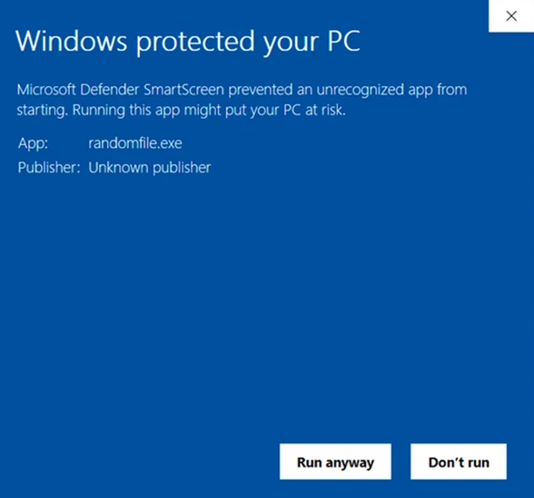

# Sekura PasteGuard

A small Windows tray app that watches your clipboard for two things. Shell commands that look like ClickFix payloads, and tracking parameters on URLs.

## Download

[Get the latest installer from the releases page](https://github.com/mkultraware/Clipboard-Defanger/releases).

## What it does

**ClickFix protection.** Attackers fake CAPTCHAs and error pages to get you to copy and run a command. PasteGuard watches the clipboard, and when it sees a shell command, it warns you before you can paste it into a terminal.

**Tracking removal.** When you copy a link from Amazon, Facebook, TikTok, LinkedIn, or Google, it comes with tracking parameters. PasteGuard strips them so you paste a clean URL.

## Detection

Two tiers, so it catches real payloads without flagging prose.

Tier 1 patterns fire on their own: `cmd /c`, `powershell -flag`, `iex`, `Invoke-WebRequest`, `DownloadString`, `curl https://`, `reg add HKEY`, base64 payloads next to a known executor, and dynamic invocation like `& ($var)`.

Tier 2 needs a tool name plus a shell signal. `mshta`, `rundll32`, `certutil`, `wmic`, and friends only trigger when followed by a flag, URL, pipe, or script extension. So "I read a blog post about mshta and rundll32 today" passes through clean.

## SmartScreen

The installer is not code-signed. If you download it from the releases page, Windows SmartScreen will show a "Windows protected your PC" warning. That is expected for an unsigned build. Click "More info" then "Run" to continue.



## Building

The repo ships source, not binaries. To build the exe and installer:

1. Install [Inno Setup 6](https://jrsoftware.org/isinfo.php)
2. Run `build.ps1`

That creates a venv, installs dependencies, builds `dist\PasteGuard.exe` with PyInstaller, and compiles the installer to `installer_output\`. To swap the app icon, drop a new PNG in as `new-icon.png` and re-run. The script converts it to the `.ico` automatically.

## Running from source

```
pip install pywin32 pystray Pillow
python clipboard_defanger.py
```

## Tray menu

Right-click the tray icon:

- Stats. Threats blocked and URLs cleaned, persisted across restarts.
- Silent mode. Kills command payloads without a dialog.
- Notifications. Toggle the tray popup on URL cleans.
- View log. Opens `~/pasteguard.log`.
- Quit.

## License

Personal use is free. Commercial use (business, enterprise, government) requires a paid license. Contact founder@sekura.se for a quote. You may not sell or repackage this software without permission.

A [Sekura](https://sekura.se) product.
